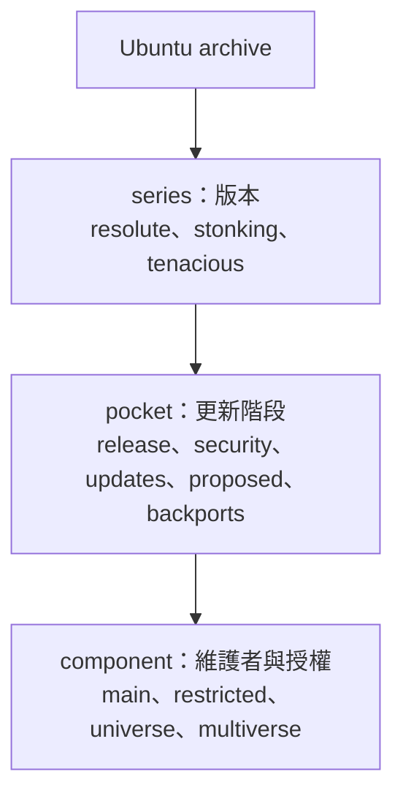

[上傳套件到自己的 PPA](ppa.md) 只是把套件放在個人套件庫。
要讓所有 Ubuntu 使用者都能 `apt install`，套件必須進入 Ubuntu 官方 archive。
這篇說明新套件進入 `universe` 的流程、各角色的職責，以及 Ubuntu 開發者的權限階層。

## Archive 的結構

Ubuntu archive 有三個維度：**series**、**pocket**、**component**，由外到內依序切分：

| 維度 | 回答的問題 | 值 |
| --- | --- | --- |
| series | 這是給哪個 Ubuntu 版本的？ | `resolute`（26.04）、`stonking`（26.10）、`tenacious`（27.04） |
| pocket | 這個版本的哪個更新階段？ | `release`、`security`、`updates`、`proposed`、`backports` |
| component | 誰維護、授權是否自由？ | `main`、`restricted`、`universe`、`multiverse` |

- **Suite**：series 加 pocket 的組合，例如 `resolute-updates`。`release` pocket 的 suite 名稱就是 series 本身（`resolute`）。
- **路徑**：archive 內的實際位置是 `dists/<suite>/<component>/`，例如 `dists/resolute-updates/universe/`。APT 的來源設定也是用 `Suites` 與 `Components` 分別指定。
- **一個套件的位置**：套件在 archive 裡由這三個維度決定。例如新套件上傳到 `tenacious`，先進 `tenacious-proposed` 的 `universe`，通過檢查後才進 `tenacious` 的 `universe`。

### Pocket

| Pocket | 內容 |
| --- | --- |
| `release` | 該 series 初次釋出時的套件。釋出後不再更新，連安全修正也不放這裡 |
| `security` | `release` 套件的安全性更新 |
| `updates` | `release` 套件的非安全性更新 |
| `proposed` | 暫存區，更新在部署給一般使用者前先在這裡驗證，使用者可以自願加入測試 |
| `backports` | 該 series 初次釋出時沒有的套件，由社群維護，沒有安全更新保證 |

`proposed` 在不同階段的用途不同：

- **釋出前（開發中的 series，例如 `tenacious`）**：上傳的套件先進 `-proposed`，通過檢查後才遷移到 `release` pocket。新套件走的就是這條路。
- **釋出後（例如 `resolute`）**：更新先進 `-proposed`，驗證後才進 `-updates`。這是 SRU 的流程，新套件不會用到。

### Component

| Component | 內容 | 一般貢獻者新套件 |
| --- | --- | --- |
| `main` | Canonical 維護的自由軟體，含安全更新 | 需要 MIR（Main Inclusion Review），不會直接進入 |
| `universe` | 社群維護的自由軟體 | 預設位置 |
| `multiverse` | 授權或散佈受限的軟體 | 少見 |
| `restricted` | Canonical 維護的專有軟體，多為驅動程式 | 少見 |

**Seed** 是 Ubuntu 用來宣告「某個產品或映像要包含哪些套件」的清單，例如 `server`、`desktop`，存放在 Launchpad 的 `ubuntu-seeds` 倉庫，不在你的 source package 裡。
被 seed 納入的套件及其相依套件屬於 `main`，不在 seed 裡的套件留在 `universe`。
所以新套件進 `universe` 不需要處理 seed；要進 `main` 或被預設安裝在映像中，才需要透過 MIR 把它加入 seed。

## 先決觀念

- **只進開發中的 series**：新套件只能進入開發中的版本（例如 `tenacious`，27.04）。已釋出的版本（例如 `resolute`，26.04）只接受 bug 修正的更新（SRU），不接受新軟體。已釋出版本的使用者要等下一個 release，或改用 PPA 或 snap。
- **Debian 優先**：若套件對 Debian 也有用，建議先進 Debian，再由 Ubuntu 從 Debian unstable 同步。這篇只談直接上傳到 Ubuntu。
- **目標是 `universe`**：這篇以進入 `universe` 為主。

## 上傳流程與角色

| 步驟 | 角色 | 做什麼 |
| --- | --- | --- |
| 1. 事前確認 | 貢獻者 | 套件在 Ubuntu 與 Debian 都沒有；授權允許散佈；上游版本穩定 |
| 2. 打包與自我驗證 | 貢獻者 | 版號使用 `-0ubuntu1`（Ubuntu 專屬套件的慣例），Lintian 乾淨，sbuild 通過，建議先放到 PPA 測試。打包方式請見 [Debian package 打包入門](packaging.md) |
| 3. 開 Launchpad bug | 貢獻者 | 說明套件用途，附上 source package（或 debdiff），並訂閱 `ubuntu-sponsors` 團隊，讓 sponsor 看到這個 bug |
| 4. 審查 | Sponsor | 有上傳權的 Ubuntu 開發者檢查打包品質與 `debian/copyright`，提出修改意見 |
| 5. 簽署並上傳 | Sponsor | 由 sponsor 把 source package 上傳到 Ubuntu archive，Launchpad 驗證簽章與格式 |
| 6. NEW queue | Archive 管理員（Ubuntu Archive team） | 新的 source 或 binary 套件不會直接進入 archive，要審查授權、套件名稱與 component |
| 7. 建置 | Launchpad build farm | 在所有支援的架構上建置，任一架構失敗，套件就停在這裡 |
| 8. 發佈到 `-proposed` | Launchpad build farm | 建置成功的 binary 發佈到 `-proposed` pocket |
| 9. 檢查 | proposed-migration（自動化系統） | 確認套件在各架構都建置成功、可安裝，且沒有讓其他套件退化。結果與擋住的原因可在 update excuses 頁面查詢 |
| 10. 遷移到 `release` pocket | proposed-migration | 通過檢查後進入該 series 本體 |
| 11. 鏡像同步 | 無 | 同步完成後，使用者執行 `apt update` 就能看到並安裝 |
| 12. 維護 | 貢獻者 | 處理 bug 與新版本，並確保新 release 開發期間仍能建置 |

- **Sponsor**：不是一種身分，而是一種行為，指有上傳權的人替沒有上傳權的人上傳。若貢獻者自己有該套件的上傳權限，可以省略 4 與 5，自己上傳；但 NEW queue 審查仍然需要。
- **Release team**：在凍結期間介入，Feature Freeze 之後審查 Feature Freeze Exception（FFe，功能凍結例外申請）。
- **被擋住時**：遷移被擋，貢獻者要自己修正並重新上傳，版號必須遞增。

## Ubuntu 開發者的權限階層

Ubuntu 開發者的權限由 Developer Membership Board（DMB）審核。

| 角色 | 範圍 |
| --- | --- |
| Contributing Developer | Ubuntu 成員身分，表示貢獻獲得認可；沒有上傳權 |
| PPU（Per-Package Uploader） | 只能上傳指定的套件 |
| Packageset 上傳者 | 能上傳一組套件 |
| MOTU | 能上傳整個 `universe` 與 `multiverse` |
| Core Developer | 能上傳所有 component，含 `main` |
| SRU Developer | 針對已釋出版本的更新 |

- 這些角色都要向 DMB 申請，不會因為上傳過套件而自動取得。
- 申請需要三到五位現任開發者背書，並說明工作領域；沒有硬性的最低 sponsored upload 數量，但要證明可以被信任進行無人監督的上傳。
- 常見的成長順序是 PPU、MOTU、Core Developer。申請 Core Developer 需要專精 `main`。
- 每個角色只能 sponsor 自己權限範圍內的套件：PPU 只限指定的套件，MOTU 限 `universe` 與 `multiverse`，Core Developer 涵蓋全部。
- 全新的套件一開始沒有 PPU 持有人，因此通常由 MOTU 或 Core Developer sponsor。

## 時程

新套件越早送審越好，因為 Feature Freeze 之後新增套件需要申請 Feature Freeze Exception（FFe，功能凍結例外申請）。
以 27.04（Tenacious T-Rex）為例，Feature Freeze 與 Debian Import Freeze 是 2027 年 2 月 25 日，Final Release 是 4 月 22 日。
實際日期以 [Ubuntu 官方的 release schedule](https://documentation.ubuntu.com/release-notes/27.04/schedule/) 為準。

## 參考資料

- [Ubuntu Developers](https://documentation.ubuntu.com/project/who-makes-ubuntu/developers/dmb-index)：Ubuntu 開發者角色與上傳權限。
- [Package archive](https://documentation.ubuntu.com/project/how-ubuntu-is-made/concepts/package-archive/)：series、pocket 與 component 的說明。
