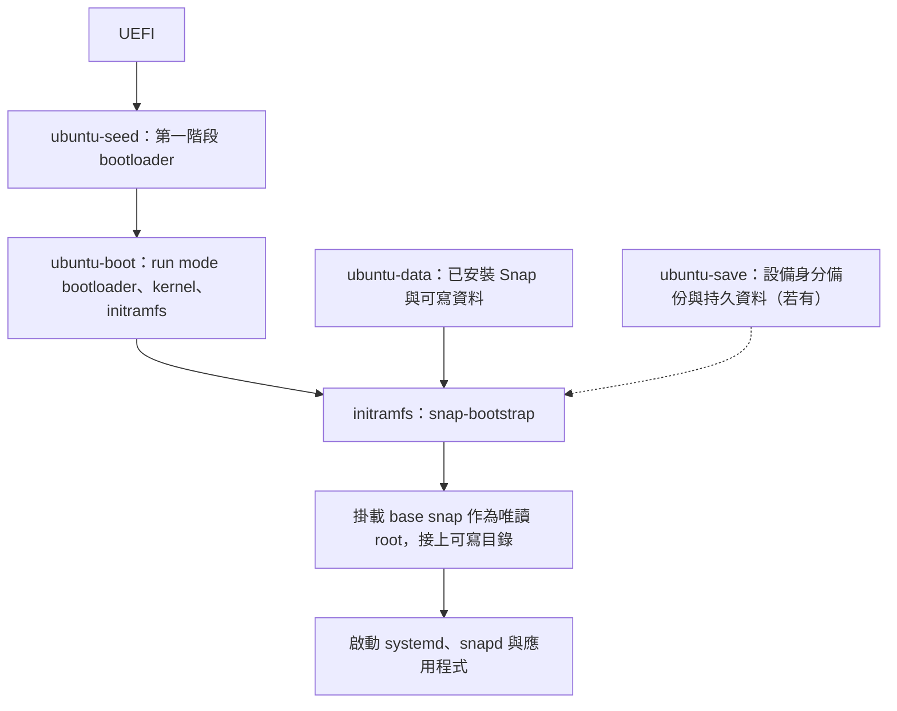

Ubuntu Core 是 Canonical 針對 IoT 與嵌入式設備設計的 Ubuntu 發行版。
系統與應用程式以 Snap 管理，支援更新與版本回復，不使用一般 Ubuntu Server 的 APT 安裝流程。
系統與 Snap 本體主要唯讀，設定及應用程式資料則放在可寫入的儲存區。
Snap 的封裝與 sandbox 機制可先參考 [Snap 概念](snap/concepts.md)。

本文以 **Ubuntu Core 24** 為例。

## 組成系統的 Snap

| 元件 | amd64 Core 24 範例 | 功能 |
| --- | --- | --- |
| Base | `core24` | 提供系統使用的基本 userspace 與函式庫 |
| Kernel | `pc-kernel`，`24/stable` | Linux kernel 與相關模組 |
| Gadget | `pc`，`24/stable` | 定義磁碟配置、bootloader、開機資產及設備設定 |
| snapd | `snapd` | 安裝、更新、驗證 Snap 與管理設備狀態 |
| Application | `console-conf` 等 | 設備服務及應用程式 |

**Model assertion** 是經過簽署的設備規格，指定架構與要安裝的 Snap，`ubuntu-image` 根據它組合磁碟映像
model 檔內會指定實際要用到的 gadget，裡面會紀錄真正的分割區配置。

## 儲存配置

以下是安裝完成後的四個主要分割區：

| 分割區 | 實際內容 | 用途 |
| --- | --- | --- |
| `ubuntu-seed` | 第一階段／recovery bootloader 資產、`snaps/` 中的初始 `.snap` 檔案，以及 `systems/<label>/` 中的 model、assertions 與 recovery 開機資訊 | 啟動安裝與 recovery 環境，提供重建系統所需的 Snap 與驗證資料 |
| `ubuntu-boot` | Run mode bootloader、開機設定，以及從 kernel snap 解出的 kernel 與 initramfs 等資產 | 載入正常運行的 kernel，啟動已安裝的系統 |
| `ubuntu-save` | 設備身分備份，以及 Snap 透過 `$SNAP_SAVE_DATA` 明確保存的少量設備資料，例如憑證與設備設定 | 在 factory reset 或重新安裝時保留指定的設備資料，不是一般使用者資料備份區 |
| `ubuntu-data` | 已安裝的 `.snap` 檔案、snapd 狀態、系統可寫設定、應用程式資料與使用者家目錄 | 保存日常運行的系統狀態與資料，提供唯讀 root filesystem 所需的可寫目錄 |

`ubuntu-seed` 在 UEFI 系統上是 FAT 格式的 EFI System Partition（ESP）。
`ubuntu-data` 和 `ubuntu-save` 是可寫資料區；`ubuntu-save` 在未加密設備上可省略，但加密設備必須有它。
實際大小與順序依 gadget 而定，尚未安裝的映像不一定已包含全部分割區。

## 開機流程

### 首次開機：install mode

1. UEFI 從 `ubuntu-seed` 啟動 bootloader，載入 seed 內 recovery system 的 kernel 與 initramfs。
2. 系統在記憶體中的暫時環境（tmpfs）進入 install mode。
3. snapd 依 gadget 建立缺少的分割區，在 `ubuntu-boot` 準備正常開機資產，在 `ubuntu-data` 準備系統資料，並初始化需要的 `ubuntu-save`。
4. 重新啟動進入 run mode，完成 Snap seeding 與首次使用者設定。

### 日常開機：run mode

`snap-bootstrap` 負責掛載所需分割區、選擇 base 與 kernel Snap；加密配置還需要先解鎖資料區。
`ubuntu-save` 不是另一個 bootloader 階段，而是掛載的輔助資料區。
Root filesystem 來自 base snap，不是直接把 `ubuntu-data` 當成整個 `/`。
若進入 recovery，則改用 `ubuntu-seed` 的 recovery system 與暫時可寫環境，不走一般 run mode 的系統啟動路徑。

## 建置映像

Ubuntu Core 映像由 [ubuntu-image](ubuntu-image/concepts.md) 依 model assertion 建置。
實際的主機設定、建置、QEMU 驗證與自訂 gadget，請參考 [使用 ubuntu-image 建置 Ubuntu Core 映像](ubuntu-image/core.md)。

## 參考資料

* [Storage layout](https://documentation.ubuntu.com/core/explanation/core-elements/storage-layout/)
* [Inside Ubuntu Core](https://documentation.ubuntu.com/core/explanation/core-elements/inside-ubuntu-core/)
* [How installation works](https://documentation.ubuntu.com/core/explanation/how-installation-works/)
