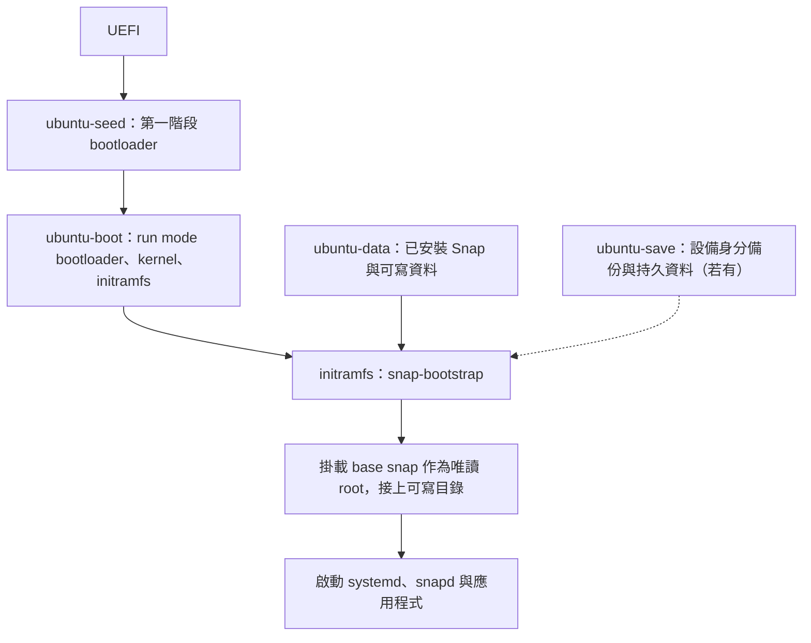

Ubuntu Core 是 Canonical 針對 IoT 與嵌入式設備設計的 Ubuntu 發行版。
系統與應用程式以 Snap 管理，支援更新與版本回復，不使用一般 Ubuntu Server 的 APT 安裝流程。
系統與 Snap 本體主要唯讀，設定及應用程式資料則放在可寫入的儲存區。
Snap 的封裝與 sandbox 機制可先參考 [Snap 機制](snap.md)。

本文以 **Ubuntu Core 24、x86-64（`amd64`）** 為例，主機使用 Ubuntu 24.04 amd64，VM 使用 QEMU/KVM。

## 組成系統的 Snap

| 元件 | amd64 Core 24 範例 | 功能 |
| --- | --- | --- |
| Base | `core24` | 提供系統使用的基本 userspace 與函式庫 |
| Kernel | `pc-kernel`，`24/stable` | Linux kernel 與相關模組 |
| Gadget | `pc`，`24/stable` | 定義磁碟配置、bootloader、開機資產及設備設定 |
| snapd | `snapd` | 安裝、更新、驗證 Snap 與管理設備狀態 |
| Application | `console-conf` 等 | 設備服務及應用程式 |

**Model assertion** 是經過簽署的設備規格，指定架構與要安裝的 Snap，`ubuntu-image` 根據它組合磁碟映像
model 檔內會指定實際要用到的 gadget，裡面會紀錄真正的分割區配置。

## 儲存配置

以下是安裝完成後的四個主要分割區：

| 分割區 | 實際內容 | 用途 |
| --- | --- | --- |
| `ubuntu-seed` | 第一階段／recovery bootloader 資產、`snaps/` 中的初始 `.snap` 檔案，以及 `systems/<label>/` 中的 model、assertions 與 recovery 開機資訊 | 啟動安裝與 recovery 環境，提供重建系統所需的 Snap 與驗證資料 |
| `ubuntu-boot` | Run mode bootloader、開機設定，以及從 kernel snap 解出的 kernel 與 initramfs 等資產 | 載入正常運行的 kernel，啟動已安裝的系統 |
| `ubuntu-save` | 設備身分備份，以及 Snap 透過 `$SNAP_SAVE_DATA` 明確保存的少量設備資料，例如憑證與設備設定 | 在 factory reset 或重新安裝時保留指定的設備資料，不是一般使用者資料備份區 |
| `ubuntu-data` | 已安裝的 `.snap` 檔案、snapd 狀態、系統可寫設定、應用程式資料與使用者家目錄 | 保存日常運行的系統狀態與資料，提供唯讀 root filesystem 所需的可寫目錄 |

`ubuntu-seed` 在 UEFI 系統上是 FAT 格式的 EFI System Partition（ESP）。
`ubuntu-data` 和 `ubuntu-save` 是可寫資料區；`ubuntu-save` 在未加密設備上可省略，但加密設備必須有它。
實際大小與順序依 gadget 而定，尚未安裝的映像不一定已包含全部分割區。

## 開機流程

### 首次開機：install mode

1. UEFI 從 `ubuntu-seed` 啟動 bootloader，載入 seed 內 recovery system 的 kernel 與 initramfs。
2. 系統在記憶體中的暫時環境（tmpfs）進入 install mode。
3. snapd 依 gadget 建立缺少的分割區，在 `ubuntu-boot` 準備正常開機資產，在 `ubuntu-data` 準備系統資料，並初始化需要的 `ubuntu-save`。
4. 重新啟動進入 run mode，完成 Snap seeding 與首次使用者設定。

### 日常開機：run mode



`snap-bootstrap` 負責掛載所需分割區、選擇 base 與 kernel Snap；加密配置還需要先解鎖資料區。
`ubuntu-save` 不是另一個 bootloader 階段，而是掛載的輔助資料區。
Root filesystem 來自 base snap，不是直接把 `ubuntu-data` 當成整個 `/`。
若進入 recovery，則改用 `ubuntu-seed` 的 recovery system 與暫時可寫環境，不走一般 run mode 的系統啟動路徑。

## 主機前置設定

以下指令在 **Ubuntu 主機** 執行。本例分配 2 GiB RAM 與 8 GiB 虛擬磁碟，並需要網際網路連線。

```bash
# 更新套件索引，安裝 QEMU、UEFI firmware 與 KVM 檢查工具
sudo apt update
sudo apt install qemu-system-x86 ovmf cpu-checker curl

# 安裝映像製作工具；--classic 允許存取主機檔案與資源
sudo snap install ubuntu-image --classic

# 檢查主機是否可使用 KVM 硬體虛擬化加速
kvm-ok
```

QEMU 提供虛擬機與虛擬裝置，KVM 則透過 Linux kernel 加速 guest CPU 執行。

確認 `kvm-ok` 可使用 KVM，且使用者有 `/dev/kvm` 存取權限。
若缺少 `kvm` 群組權限，可執行 `sudo usermod -aG kvm "$USER"`，再登出並重新登入。
其中 `-aG` 將目前使用者加入額外群組，不移除原有群組；`$USER` 是目前使用者名稱。

另外我們需要先建立 [Ubuntu One 帳號](https://login.ubuntu.com/)，並在 [SSH keys](https://login.ubuntu.com/ssh-keys) 登錄 SSH **公鑰**，供首次設定與 SSH 登入使用。
這個和 Desktop / Server 的邏輯不一樣，因為 Ubuntu Core 通常是大量部屬，利用 Ubuntu One 就可以避免每次安裝都要設定帳號密碼的資訊。

## 建置 x86-64 映像

使用 Canonical 已簽署的參考 model，不需要自己的簽署金鑰：

```bash
mkdir -p ~/ubuntu-core-vm
cd ~/ubuntu-core-vm

# 下載已簽署的 model，也就是前面提過的 model assertion
# -f 檢查 HTTP 錯誤，-L 跟隨重新導向，-o 指定檔名
curl -fL -o ubuntu-core-24-amd64.model \
  https://raw.githubusercontent.com/canonical/models/master/ubuntu-core-24-amd64.model
mkdir -p build

# 依 model 組合 8 GiB 映像到 build/，並加入首次設定用的 console-conf
ubuntu-image snap \
  --image-size 8G \
  --output-dir build \
  --snap console-conf \
  ubuntu-core-24-amd64.model

# 複製成 VM 工作磁碟；--sparse=always 減少連續零值區域的實際占用
cp --sparse=always build/pc.img ubuntu-core.img
```

輸出為 `build/pc.img`，這裡複製成 `ubuntu-core.img` 供 VM 使用。
Core 24 的參考 model 將 `console-conf` 標為 optional，因此需要明確加入。

## 在 QEMU 上執行

### 準備 UEFI firmware

在同一個工作目錄執行，**每個新 VM 各做一次**：

```bash
# 複製唯讀 UEFI code 到目前目錄 (UEFI 程式碼的部份，用來初始化)
cp /usr/share/OVMF/OVMF_CODE_4M.secboot.fd .

# 建立這台 VM 專用的可寫 UEFI variables (UEFI 的設定部份，如開機順序)
cp /usr/share/OVMF/OVMF_VARS_4M.ms.fd .
```

同一個 VM 重啟時沿用原來的 VARS，不要每次重新覆蓋。

### 啟動 VM

以下使用沒有 TPM 的配置，不測試磁碟加密；透過 QEMU 圖形視窗操作首次設定：

```bash
# 使用 KVM、Q35 與主機 CPU 功能，分配 2 個 vCPU、2048 MiB RAM，停用 S3 睡眠
# virtio 網卡使用 NAT，將主機 127.0.0.1:8022 轉送到 VM 的 SSH port 22
# pflash 掛載唯讀 UEFI code 與可寫 variables；virtio 磁碟使用 raw 映像
# serial console 與 QEMU monitor 共用目前終端
qemu-system-x86_64 \
  -enable-kvm \
  -machine q35 \
  -cpu host \
  -smp 2 \
  -m 2048 \
  -global ICH9-LPC.disable_s3=1 \
  -netdev user,id=net0,hostfwd=tcp:127.0.0.1:8022-:22 \
  -device virtio-net-pci,netdev=net0 \
  -drive file=OVMF_CODE_4M.secboot.fd,if=pflash,format=raw,unit=0,readonly=on \
  -drive file=OVMF_VARS_4M.ms.fd,if=pflash,format=raw,unit=1 \
  -drive file=ubuntu-core.img,if=none,format=raw,id=disk1 \
  -device virtio-blk-pci,drive=disk1,bootindex=1 \
  -serial mon:stdio
```

這是 raw 磁碟映像，不是 ISO。同一個映像不能同時交給兩個 VM 使用。

### 首次啟動與 SSH

1. 等待首次安裝與重新啟動完成。
2. 在 QEMU 視窗的 `console-conf` 設定網路，輸入已登錄 SSH 公鑰的 Ubuntu One 帳號 Email。
3. 記下畫面顯示的本機使用者名稱，從主機登入：

```bash
# -i 指定 SSH 私鑰，-p 使用主機轉送到 VM 的 port
ssh -i ~/.ssh/id_ed25519 -p 8022 YOUR_USERNAME@127.0.0.1
```

`YOUR_USERNAME` 是本機使用者名稱，不是 Email；私鑰路徑請依自己的設定調整。

登入後可在 **VM 內**確認版本與配置：

```bash
# 列出已安裝的 Snap 與 revisions
snap list

# 顯示設備使用的完整 model assertion
snap model --assertion

# 列出磁碟與分割區；-o 指定名稱、大小、檔案系統、標籤與掛載位置
lsblk -o NAME,SIZE,FSTYPE,LABEL,MOUNTPOINTS
```

完成後用 `sudo poweroff` 關機；下次執行相同 QEMU 指令即可。

## 參考資料

* [Storage layout](https://documentation.ubuntu.com/core/explanation/core-elements/storage-layout/)
* [Inside Ubuntu Core](https://documentation.ubuntu.com/core/explanation/core-elements/inside-ubuntu-core/)
* [How installation works](https://documentation.ubuntu.com/core/explanation/how-installation-works/)
* [Use ubuntu-image](https://documentation.ubuntu.com/core/how-to-guides/image-creation/use-ubuntu-image/)
* [Test on QEMU](https://documentation.ubuntu.com/core/how-to-guides/manage-ubuntu-core/test-on-qemu/)
