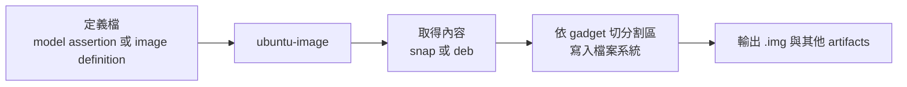

本文只說明概念，不包含實作指令。
實際操作請看 [建置 Core 映像](core.md) 與 [建置 Classic 映像](classic.md)。
安裝 `ubuntu-image` 的前置需求集中在本文的「前置需求與安裝」。

## ubuntu-image 是什麼

`ubuntu-image` 是產生可開機磁碟映像的工具。
它讀取一份「定義檔」，取得需要的內容，依 gadget 描述的配置切出分割區、寫入檔案系統，最後輸出映像檔。



## 兩條建置路線

`ubuntu-image` 有兩個子指令，對應兩種不同的輸入與內容來源：

| 項目 | Snap-based | Classical |
| --- | --- | --- |
| 子指令 | `ubuntu-image snap` | `ubuntu-image classic` |
| 輸入 | 已簽署的 model assertion | Image definition（YAML） |
| 內容來源 | Snap（kernel、gadget、base、snapd 等） | Deb 套件 |
| 產出 | Ubuntu Core 映像 | Preinstalled 的 Ubuntu Server / Desktop 等映像 |

## 重要名詞

### Model assertion

經過簽署的設備規格，指定架構、base、kernel、gadget 與其他要安裝的 Snap。
`ubuntu-image snap` 只需要它就能組出映像，設備的內容由它唯一描述。
Core 的組成請參考 [Ubuntu Core 入門](../ubuntu-core.md)。

### Image definition

Classical 路線的輸入 YAML，描述映像內容與輸出格式。主要區塊有：

| 區塊 | 用途 |
| --- | --- |
| `gadget` | 如何取得 gadget，用來產生開機資產與分割區配置 |
| `rootfs` | 如何建立 root filesystem 的內容 |
| `artifacts` | 要產生的成品，包含映像、manifest 等 |

### Gadget 與 `gadget.yaml`

Gadget 描述映像的硬體相關配置，兩條路線都會用到。
其中的 `gadget.yaml` 定義：

* 要產生哪些 volume（概念上相當於一個磁碟映像）。
* Volume 內有哪些 structure，也就是分割區、啟動紀錄等配置。
* 是否包含 bootloader，以及種類。

### Preinstalled image

Classical 路線產出的是「已預先安裝好的映像」，燒錄後就可開機。
這和安裝媒體（ISO）不同：ISO 開機後還要跑安裝程式。

## 如何選擇

| 需求 | 建議 |
| --- | --- |
| IoT、嵌入式設備、需要 Snap 與可回復更新 | Core（`snap`） |
| 使用 APT 的一般 Ubuntu Server 預安裝映像 | Server（`classic`） |
| 使用 APT 的一般 Ubuntu Desktop 預安裝映像 | Desktop（`classic`） |

## 前置需求與安裝

各實作頁面共用以下前置需求：

* Ubuntu 20.04 或更新版本，官方建議使用 Ubuntu 24.04。
* 主機可以安裝 Snap（需要 snapd）。
* 需要網際網路連線，用來下載 Snap 或 deb 套件。

`ubuntu-image` 以 Snap 發佈，安裝方式如下：

```bash
# --classic 允許存取主機檔案與資源
sudo snap install ubuntu-image --classic
```

`ubuntu-image` 需要 root 權限，通常以 `sudo` 或 root 執行。
各映像專用的工具（例如驗證用的 QEMU）會寫在各自的頁面。

## 參考資料

* [canonical/ubuntu-image](https://github.com/canonical/ubuntu-image)
* [ubuntu-image syntax and options](https://canonical-subiquity.readthedocs-hosted.com/en/latest/reference/ubuntu-image.html)
* [Use ubuntu-image](https://documentation.ubuntu.com/core/how-to-guides/image-creation/use-ubuntu-image/)
